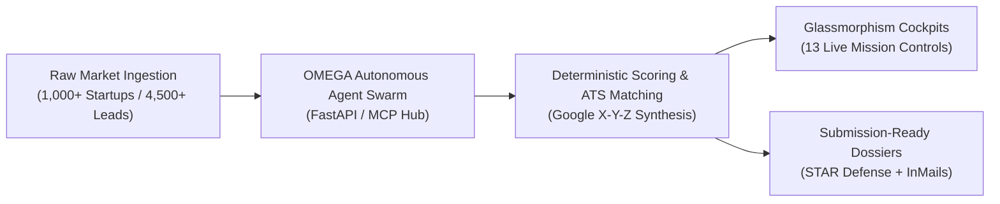

<div align="center">

# ⚡ ADITYA MEHRA
### Autonomous AI Systems Architect • Commercial Operations Strategist • Full-Stack Builder
**Bengaluru, Karnataka, India 🇮🇳**

<br/>

<a href="https://github.com/AdityaMehra007">
  
</a>

<br/><br/>

[](mailto:ashishiash007@gmail.com)
[](https://github.com/AdityaMehra007/anti)
[](https://adityamehra007.github.io)
[](https://maps.google.com/?q=Bengaluru)
[](mailto:ashishiash007@gmail.com)

---

[Executive Overview](#-executive-overview) • [Flagship Architecture](#-flagship-engineered-systems) • [Mission Control Cockpits](#-live-mission-control-cockpits) • [Proof of Work](#-statutory-proof-of-work-pow) • [Tech Arsenal](#%EF%B8%8F-technical-arsenal) • [GitHub Velocity](#-github-velocity--activity) • [Direct Contact](#-direct-contact--gateways)

---

</div>

## 🌐 Executive Overview

> *"The highest-value engineering in the AI era belongs to commercial operators who direct autonomous coding swarms with architectural clarity, deep domain grounding, and unfakeable statutory proof."*

I operate at the convergence of **Autonomous AI Engineering** and **High-Stakes Commercial Operations**. 

Rather than treating AI as an autocomplete toy, I build and operate **autonomous multi-agent swarms**, **Model Context Protocol (MCP) ecosystems**, **deterministic business state machines**, and **real-time market radars**—all rigorously verified by hermetic, 100% test-driven harnesses.

```
┌────────────────────────────────────────────────────────────────────────────────────────┐
│                        ADITYA MEHRA — ENTERPRISE VALUE DUALITY                         │
├────────────────────────────────────────┬───────────────────────────────────────────────┤
│ 💼 COMMERCIAL & OPERATIONAL RECORD     │ 🤖 AUTONOMOUS AI & DISTRIBUTED SYSTEMS        │
├────────────────────────────────────────┼───────────────────────────────────────────────┤
│ • ₹1.60Cr – ₹1.80Cr+ GMV scale (26AS)  │ • OMEGA 19-in-1 Omni-Agent Swarm Hierarchy    │
│ • IRDAI Regulated Advisor (>85% Pers.) │ • MCP Master Fleet Hub (260 Tools / 24 Srvs)  │
│ • Aero India 2025 Zero-Downtime Ops    │ • Bengaluru Startup Radar (1,000+ Startups)   │
│ • Corporate Audits: Tata Comm & Puma   │ • 3,837 Autonomous Agent Capability Skills    │
│ • BBA Intl Business (DSU Bengaluru)    │ • 100% Test-Driven Hermetic Quality Gateways  │
└────────────────────────────────────────┴───────────────────────────────────────────────┘
```

---

## 🚀 Flagship Engineered Systems

### 1. [OMEGA: Autonomous Agent Architecture & Operating System](https://github.com/AdityaMehra007/anti)
> **Master Sovereign Engine • Python, FastAPI, Model Context Protocol, 3,837 Skills**

* **19-in-1 Omni-Agent Architecture**: Autonomous execution DAG coordinating research, strategy, code generation, verification, and automated operations.
* **Bengaluru Supreme Startup Radar (BSIE-X)**: Market telemetry analyzing **1,000+ startups, 75 live roles, 16 VC rounds, and 234 chronological market deltas** with FTS5 search.
* **Model Context Protocol (MCP) Hub**: 260 schema-validated tools across 24 servers with composite stdio multiplexer and multi-client config exporters.
* **100% Hermetic Test Gateways**: 406/406 verified tests across database schemas, API contracts, ATS parsers, and autonomous pipelines.



---

### 2. [Eventos-Omega: Large-Scale Event Operations Engine](https://github.com/AdityaMehra007/Eventos-Omega)
> **Enterprise Event Logistics Platform • Kotlin, Jetpack Compose, Room SQLite, Google Gemini AI**

* High-concurrency event operations engine tracking crowd throughput, vendor scheduling, emergency medical dispatches, and budget reconciliation.
* Backed by **Google Gemini AI** for real-time crowd safety incident prediction and offline-first Room persistence.
* Validated against high-stakes logistics standards derived from on-ground Aero India 2025 operations.

---

### 3. [BUSINESS-OS-: Deterministic Business Tycoon Engine](https://github.com/AdityaMehra007/BUSINESS-OS-)
> **Enterprise Business Operating System • Kotlin, Jetpack Compose Material 3, Clean Architecture**

* Deterministic operational state machines modeling enterprise treasury banking, global supply chain corridors, human resource workflows, and financial reconciliation.
* Unidirectional Data Flow (UDF) architecture with reactive Kotlin Coroutines, StateFlow, and zero external runtime dependencies.

---

### 4. [ADI-OS: Modular Android System Control Platform](https://github.com/AdityaMehra007/ADI-OS)
> **Modular Android Systems Architecture • Kotlin, Android SDK, WorkManager, Device Telemetry**

* Modular device telemetry and background automation engine with adaptive power management, background task dispatching, and hardware sensor telemetry.
* Clean architecture with reactive state flows, offline-first persistence, and CI build automation.

---

### 5. [Aditya Mehra Official Universe Portfolio](https://github.com/AdityaMehra007/AdityaMehra007.github.io)
> **AI-Native Interactive Web Portfolio • [Live Demo: adityamehra007.github.io](https://adityamehra007.github.io)**

* Glassmorphism executive portfolio presenting real-time project telemetry, verified case studies, interactive resume viewers, and recruiter booking interfaces.

---

## 🎛️ Live Mission Control Cockpits

Thirteen high-performance, single-file glassmorphism HTML dashboards engineered in [`anti`](https://github.com/AdityaMehra007/anti) with zero external build dependencies:

| Cockpit Name | Scope & Capabilities | Engine Backing |
| :--- | :--- | :--- |
| **OMNI Executive Cockpit** | Meta-dashboard linking all 14 suites, 6 live cockpits, and 16,553 vacancies | FastAPI / SQLite |
| **Bengaluru Startup Radar** | 7-tab live radar: 1,000 startups, 75 roles, 16 funding rounds, FTS5 search | SQLite / BSIE-X |
| **MCP Master Fleet Cockpit** | Real-time telemetry for 260 tools across 24 MCP servers + 1-click config export | JSON-RPC 2.0 Hub |
| **APEX Career OS** | 7-agent closed-loop career conquest engine with STAR interview defense | Python / SQLite |
| **Coolify Cloud Control** | Cloud cluster management, edge routing telemetry & 352-service marketplace | Docker / Traefik |
| **Plane Issue Cockpit** | Sprint velocity curves, burndown metrics & Kanban issue lifecycle | REST / WebSocket |

---

## 📜 Statutory Proof of Work (PoW)

*Every claim is backed by statutory Government of India records, regulatory licenses, and operational manifests:*

| Verification Dimension | Statutory Proof Document | Governing Body / Entity | Verified Commercial Metric |
| :--- | :--- | :--- | :--- |
| **Commercial Scale (7 Years)** | Form 26AS / AIS (Section 194H) | Income Tax Dept., Govt. of India | **₹1.60Cr to ₹1.80Cr+ Annual GMV**; 7,500+ Group BP/cycle; 50+ Team. |
| **Regulated Advisory (3 Years)** | Form 16A (Section 194D) & IRDAI License | IRDAI / Bajaj Allianz | **>85% Client Persistency Ratio**; zero infractions; HNI portfolio servicing. |
| **Inside Sales Velocity** | Appointment Letter & Dialing Logs | BrightCHAMPS Edtech Pvt. Ltd. | **60+ Consultative Discovery Calls/Shift**; North American parent closing. |
| **High-Stakes Live Staging** | Operational Accreditation | Aero India 2025 / Defense Expo | **1,000+ Attendee AV, Staging & Hardware Logistics** (Zero Downtime). |
| **Corporate Asset Audits** | Internship Completion & Audit Logs | Tata Communications & Puma Sports | Multi-location IT asset reconciliation & retail operations audit. |
| **Accredited Degree** | Degree Certificate & Official Transcripts | Dayananda Sagar University (DSU) | **BBA in International Business (Class of 2026)**; UGC accredited. |

---

## 🛠️ Technical Arsenal

<div align="center">

### Core Languages & Runtimes


### Autonomous AI & Swarm Infrastructure

-000000?style=for-the-badge&logo=anthropic&logoColor=white)


### Frameworks, Backends & Mobile


### Databases, Cloud & Quality Assurance


-0A9EDC?style=for-the-badge&logo=pytest&logoColor=white)


</div>

---

## 📈 GitHub Velocity & Activity

<div align="center">

### 🗓️ 365-Day Real-Time Activity Calendar
<a href="https://github.com/AdityaMehra007">
  
</a>

<br/><br/>

### ⚡ Velocity, Streak & Languages Footprint

<table border="0" align="center">
  <tr align="center">
    <td>
      
    </td>
    <td>
      
    </td>
  </tr>
  <tr align="center">
    <td colspan="2">
      <br/>
      
    </td>
  </tr>
</table>

</div>

---

## 📬 Direct Contact & Gateways

I am actively available for high-velocity roles in **AI Operations, Systems Architecture, Technical Operations, or Founder's Office**:

* 📍 **Location:** Bengaluru, Karnataka, India *(Immediate Joining)*
* 📧 **Official Email:** [ashishiash007@gmail.com](mailto:ashishiash007@gmail.com)
* 🌐 **Live Portfolio:** [adityamehra007.github.io](https://adityamehra007.github.io)
* 🐙 **GitHub:** [@AdityaMehra007](https://github.com/AdityaMehra007)
* 💼 **Flagship Repo:** [github.com/AdityaMehra007/anti](https://github.com/AdityaMehra007/anti)

<br/>

<div align="center">
  <sub>⚡ Engineered, verified, and directed with relentless precision by Aditya Mehra.</sub>
</div>
